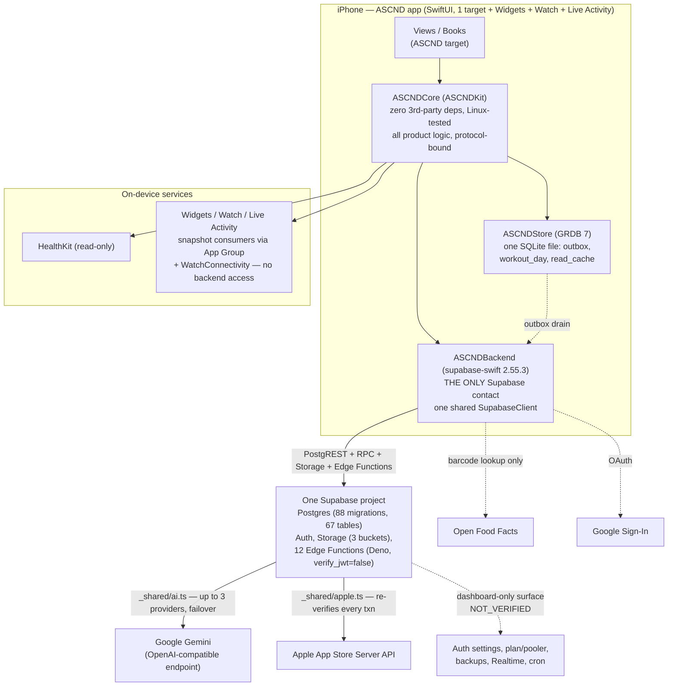
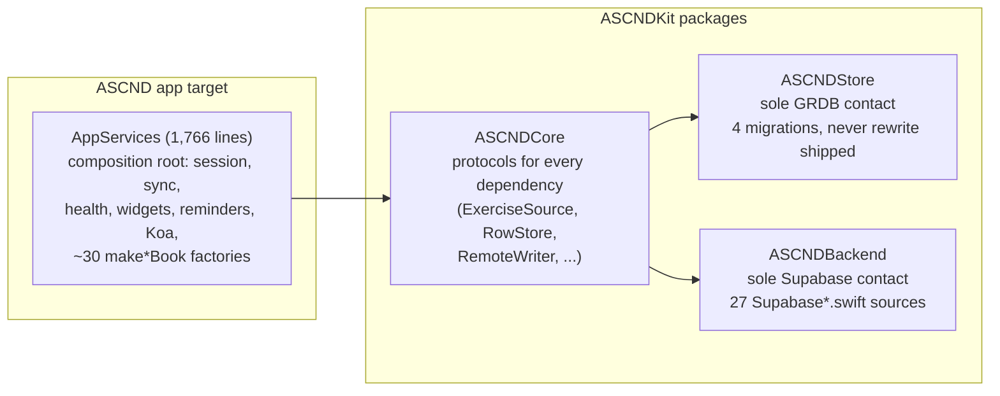
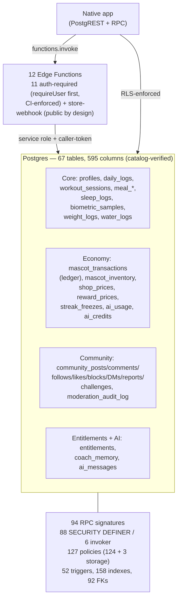
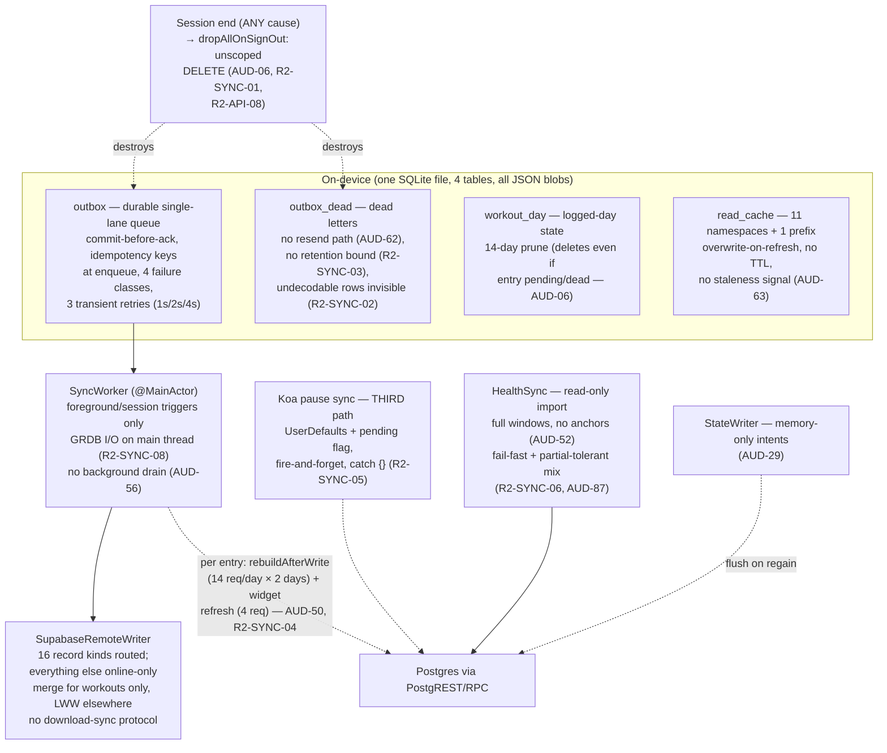
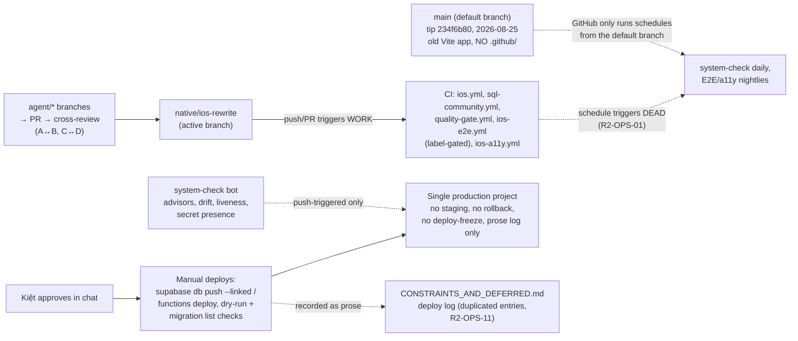

# ASCND Round 2 — Architecture Review

Tip: `native/ios-rewrite` @ `b19e9822`. Standard: native iOS app. This review judges the native architecture on its own terms, benchmarked against the product's own requirements — not against the legacy RN build.

## 1. Verdict

The architecture is **sound in structure, thin in operations**. The layering is genuinely good — the cleanest part of the system is the client package boundaries, and the strongest subsystem is the offline outbox core. The weaknesses are concentrated in three places: (1) the single Supabase project as the sole point of failure with no staging, no verified backups, and manual deploys; (2) the trust boundary — gamification and readiness truth is client-asserted while the server enforces only shape and price; (3) the absence of any detection layer — nothing observes the system once it runs. No platform migration or rewrite is justified; every gap is fixable in place.

Architecture scorecard (Round 2, 0–10, evidence-grounded; changes vs Round 1 noted):

| Category | R1 | R2 | Justification |
|---|---|---|---|
| Database architecture | 6 | 6 | Unchanged. JSONB set model (AUD-08), 25 unindexed FKs (AUD-10, corrected count), dead tables (AUD-11), duplicate indexes (AUD-16), no search indexing (AUD-09). |
| Database integrity | 5 | 5 | Unchanged. Economy/HealthKit idempotency exemplary; gamification/readiness client-asserted (AUD-02/03/20/25); core CHECKs absent (AUD-22); no reconciliation (AUD-19); no audit trail (AUD-31). |
| Security | 7 | 7 | Unchanged. RLS 67/67, no secrets, strong admin/purchase paths. AUD-38 non-reproduction and AUD-41 correction improve the picture slightly; R2-DB-01 oracle + AUD-02 keep it at 7. Dashboard surface still UNVERIFIED. |
| Authentication & authorization | 7 | 7 | Unchanged. Keychain sessions, nonces, `requireUser` closing the anon bypass (now proven CI-enforced, AUD-37). Dragged down by AUD-21 (no re-auth for deletion), R2-API-10 (recovery-link session), unverified dashboard settings. |
| Backend logic | 6 | 6 | Unchanged. Edge functions carefully built; gamification truth misplaced; duplicated rules (AUD-24, CI half now resolved); dead query (AUD-71); unvalidated AI outputs (AUD-70); new: quota-burn shapes (R2-API-02/03), no idempotency/refund. |
| API design | 6 | 5 | **Down 1.** No stable error contract (R2-API-06: clients sniff message strings); unbounded reads (AUD-05/27/28); no versioning story; DM/inbox pagination defects (AUD-49); direct-RPC oracles (AUD-40, R2-DB-01). |
| Performance | 5 | 5 | Unchanged. Per-user paths indexed/paged/batched; global paths not (AUD-09/50/51); new: RLS initplan tax (R2-OPS-02), widget amplification (R2-SYNC-04), timeout mismatch (R2-OPS-04). |
| Scalability | 5 | 5 | Unchanged. Fine to 10k; degradation at 100k; not ready at 1M without search/index work. Plan/pooler UNVERIFIED. |
| Offline synchronization | 6 | 6 | Unchanged. Outbox core excellent; sign-out loss (AUD-06, expanded), cross-account delete (R2-SYNC-01), no background drain (AUD-56), silent LWW (AUD-29), no cache TTL (AUD-63), invisible undecodable rows (R2-SYNC-02). |
| Reliability | 4 | 3 | **Down 1.** Scheduled CI never runs (R2-OPS-01) removes the one periodic control Round 1 credited; zero error reporting (R2-OPS-03); no verified backups (AUD-01); no staging/rollback (AUD-07); manual single-machine release (R2-OPS-06). |
| Testing | 6 | 5 | **Down 1.** SQL suites + mutation testing remain strong (re-executed this round); but the Deno test has no runner (R2-OPS-07), E2E nightlies are dead (R2-OPS-01), no full-chain CI job (AUD-13), no perf gates (R2-OPS-10), Swift suite passage NOT_VERIFIED here. |
| Production readiness | 4 | 4 | Unchanged. Purchases unshippable (AUD-04), freezes unspendable (AUD-14, UI-unreachable), no verified recovery (AUD-01), no staging (AUD-07), telemetry unverified (AUD-58), privacy claim unevidenced (R2-OPS-09). |

## 2. Runtime topology

Notes:

- **No Realtime usage at all** (zero `channel(`/`subscribe(` in Swift; no publication SQL; dashboard state NOT_VERIFIED). DMs/notifications/feeds are fetch-on-appear + pull-to-refresh (AUD-59, precision-corrected).
- **No CDN, queue, cache layer, or second region.** No server push (APNs + token table explicitly not built); local notifications only.
- **Single region** — region NOT_VERIFIED.
- **Two URLSessions, two timeout policies:** `Backend` uses a dedicated session (25 s request timeout + stall recovery); `SupabaseCoachStream` uses `URLSession.shared` (60 s default, no stall recovery) — deliberate for SSE, but the two paths fail differently (AUD-67, R2-OPS-04).

## 3. Client layering (what is genuinely good)

- **The package boundaries hold and are mechanically enforced:** the Linux CI job (`core-linux`) fails the build if UIKit/SwiftUI leaks into Core. ASCNDCore depends only on protocols; all 27 `Supabase*.swift` sources live in ASCNDBackend.
- **Feed hydration is batched, not N+1:** `CommunityFeed.hydrate` issues 4 parallel `IN()` queries per 30-row page; comments, DM inbox profiles, and challenge hydration follow the same pattern. No per-row request loop was found in the feed path.
- **Explicit column lists almost everywhere:** only 2 `select("*")` sites in Swift (both bounded). Edge functions are looser (`select("*")` in 3 AI functions — AUD-71, R2-OPS-08).
- **Coupling watch:** `AppServices` is the largest single coupling surface (nearly every feature view reaches the backend through it; `@Observable`, MainActor-bound, constructed whole). No finding raised — the package boundaries below it hold — but it is the most likely merge/conflict hotspot and the hardest to unit-test in isolation.

## 4. Data topology (server)

- **RLS on 67/67 tables.** Every table has a primary key; the deletion graph is cascade-complete (89 CASCADE actions).
- **88 SECURITY DEFINER functions** (AUD-15): nearly all product integrity bypasses RLS by construction. No exploitable defect was found in the definer bodies reviewed except the two read-only oracles (AUD-40, R2-DB-01). The mitigation is the SQL suites + mutation testing + revokes — all of which must keep running.
- **Economy writes are RPC-only with advisory locks and idempotency keys** (verified: direct INSERTs into `mascot_transactions`, `entitlements`, `community_posts` → `42501`, T-PX). The economy RPCs are genuinely correct; only the *earning-verification* boundary is weak (AUD-02/03/25).
- **JSONB set/program model** (AUD-08): `workout_sessions.sets` and `workout_templates.exercises` are free-form JSONB with no shape CHECK, FK, or index. PR detection, volume aggregation, and per-exercise history are impossible in SQL; everything is client-computed and trusted. The largest structural gap; plan as a versioned migration with dual-write cutover, not a flag day.
- **Three identity tables** (AUD-18): `auth.users` + `profiles` (surrogate `id` never referenced by any FK) + `community_profiles`; settings scattered across 4 tables.
- **No enums anywhere;** two style eras (`UUID` vs `uuid`); 10 JSONB columns; 0 views; 0 extensions (AUD-83, AUD-09).
- **Dead/legacy surface:** 4 tables with no native use (AUD-11); `community_request_review` with no caller anywhere (AUD-61); `claim_ai_call` with no live edge caller (AUD-66); `verify-purchase`/`admin-art` with no live caller and NOT_DEPLOYED_BY_DESIGN.

## 5. Sync topology (offline-first)

- **The outbox core is the strongest subsystem in the codebase** (commit-before-ack, idempotent replay, account fencing, retry classification, fuzz-tested invariants). Extend it; do not replace it.
- **The online-only surface is large:** community/DM/AI/economy/photos fail immediately offline with no queue. This is a product-shape fact, not a defect per se — but it bounds what "offline-first" means.
- **Three sync paths exist** (outbox, Koa pause ad-hoc path, HealthSync import) plus memory-only state intents. The Koa path bypasses every guarantee the outbox provides (R2-SYNC-05).
- **No download-sync protocol:** the client never reconciles server state downward except via read-cache refreshes; multi-device conflicts are silent LWW except workout revisions (AUD-29).

## 6. Deploy & CI topology

- **Branch protection / required-check configuration is NOT_VERIFIED** (needs authenticated API access). `ios.yml` is explicitly not a required check (ADR-0002); `ios-e2e.yml` explicitly not required; `ios-analysis.yml` is `continue-on-error`.
- **Merge rule in repo docs:** merge commit, no squash, CI green on the exact head.
- **Release:** manual, single-machine (R2-OPS-06). No CI release build, no automated TestFlight upload, no staged rollout/rollback plan. Telemetry keys live only on the Archive machine.

## 7. Trust boundaries (the central architectural question)

| Boundary | Server enforces | Client asserts (trusted) | Verdict |
|---|---|---|---|
| Economy earning | Shape, price, ceiling, idempotency, advisory locks | **Completion** (AUD-02), award eligibility (AUD-03), challenge progress inputs (AUD-25), Gains rank (R2-ECO-10) | **Misplaced.** The server is the cashier, not the auditor. Works while coins are cosmetic; escalates to CRITICAL if coins gate value. |
| Readiness / daily aggregates | Nothing (owner policy, no CHECKs) | Score, status, explain tokens (AUD-20); AI functions consume as ground truth | **Misplaced.** At minimum CHECKs (0–100, token format); ideally server recompute/validation. |
| Workout data | Ownership, idempotency | Sets shape, volume, PR flags, dates (AUD-08/25) | **Accepted risk today** (self-data), but blocks any server-side verification or analytics. |
| Entitlements / purchases | Everything (re-verifies with Apple, trusts nothing) | Nothing | **Correct.** The template for the other boundaries. |
| Moderation / community | Guards, triggers, audited RPCs, immutability | Almost nothing | **Correct.** The most rigorously constrained domain; the template for fixing `awards`. |
| AI quotas | Per-user daily caps, kind shape | Nothing (edge passes fixed literals) | **Mostly correct.** Gaps: unknown-kind row bound regressed (R2-API-01), no aggregate budget (AUD-54), no refund (R2-API-03). |

**Recommendation:** decide the trust boundary once, for all reward-bearing rules together (AUD-02/03/25 + R2-ECO-01/10/13), rather than fixing one path and leaving the next open. The community moderation architecture already demonstrates the right pattern (server-verified RPCs, audited, trigger-enforced); apply it to awards and quest claims.

## 8. What should NOT be rewritten

- The **outbox/sync core** — extend it (background drain, resend path, scoped delete), don't replace it.
- The **economy RPCs** (pricing, advisory locks, idempotency, ceilings) — genuinely correct; only the earning-verification boundary needs work.
- The **purchase/entitlement server half** — trusts nothing, re-verifies with Apple; build the client half onto it.
- The **SQL test suites + mutation testing** — real, passing, the main defense for the 88 definer functions; extend them (full-chain CI job), don't discard them.
- The **community moderation/trigger architecture** — the template for fixing `awards`.
- **Supabase itself** — no finding justifies a platform migration; all scaling and integrity issues are fixable in place. The one architectural change worth planning is relational workout sets/programs (AUD-08) — a schema evolution inside Postgres, not a migration away from it.

*End of architecture review.*
