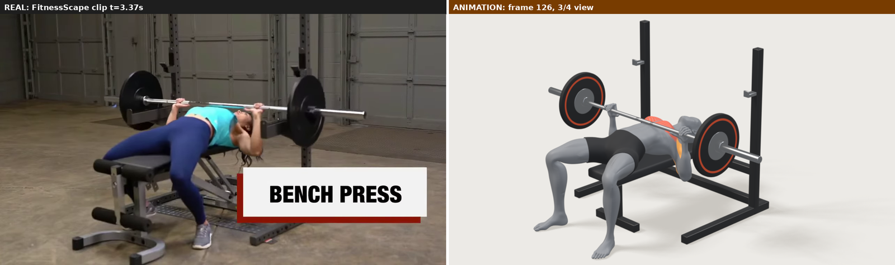
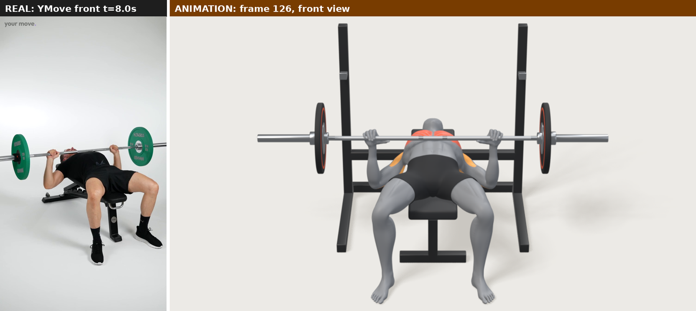
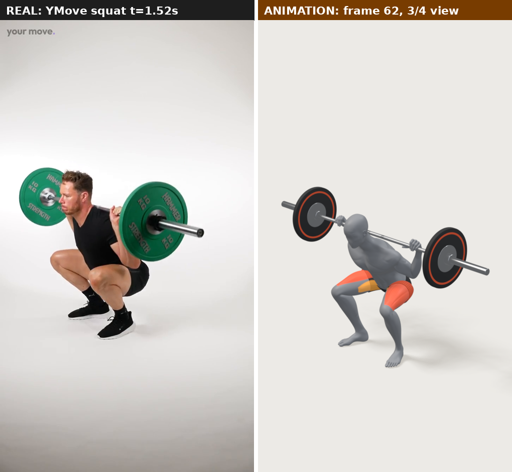
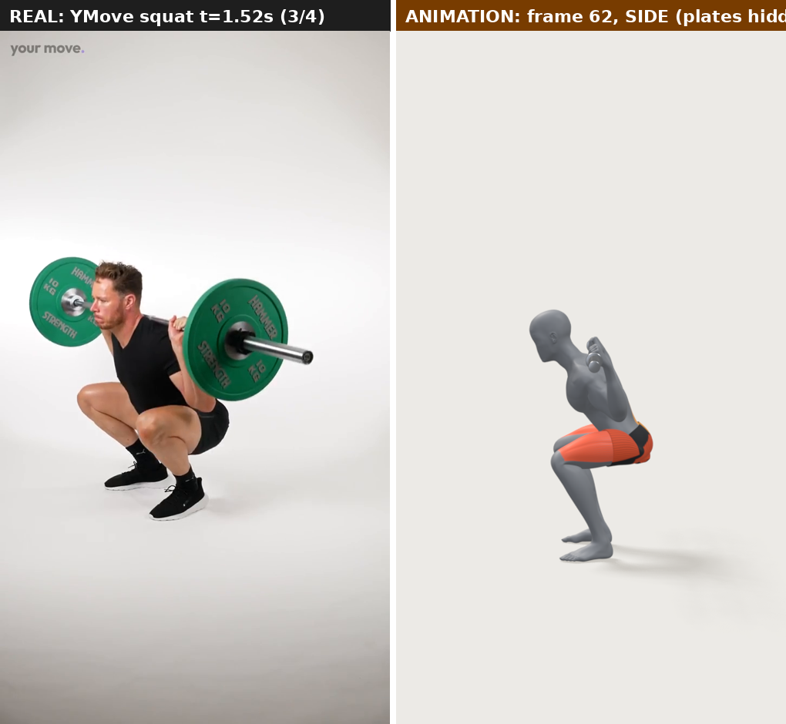
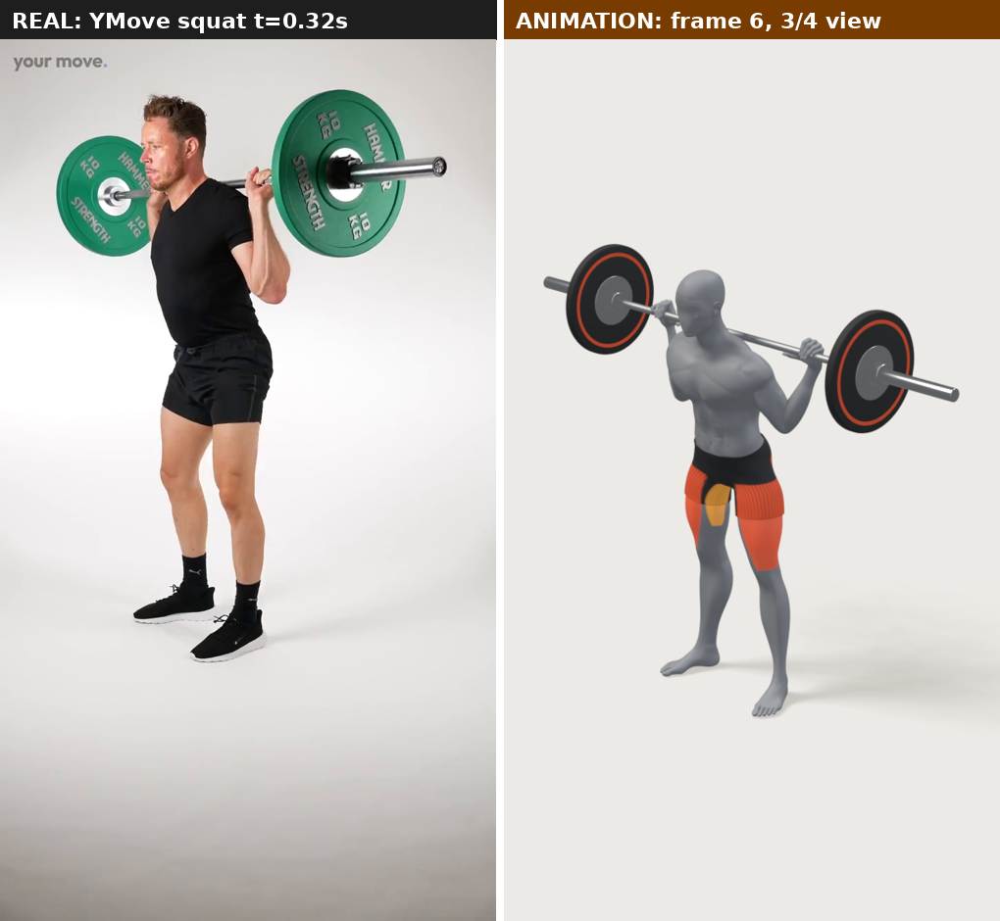
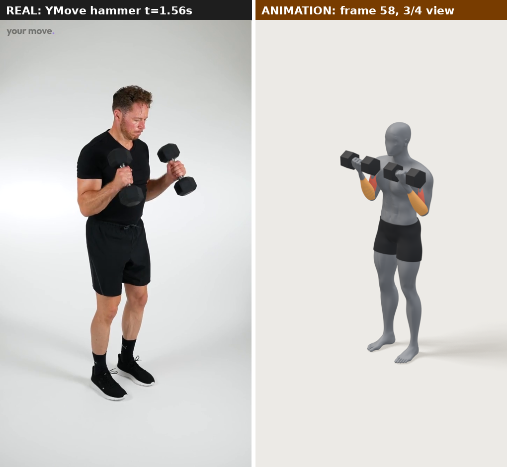
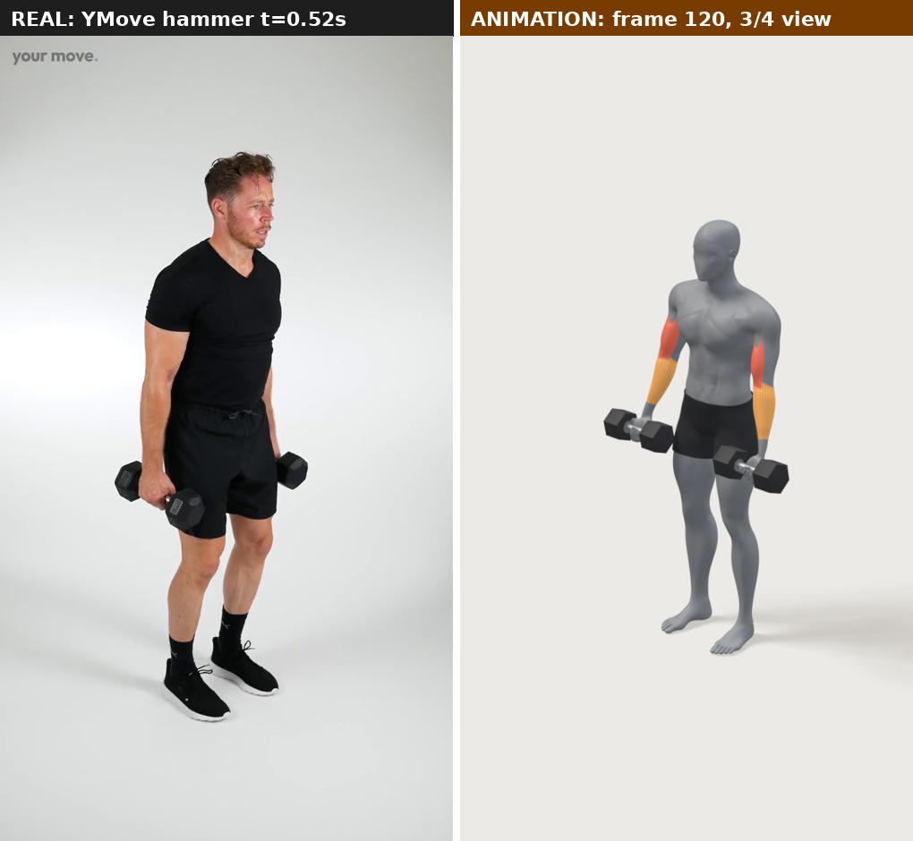

# Reference-clip evaluation of the 3D exercise guides — 2026-11-14

- **Evaluator:** C (subagent, evaluation only — no finalization, no status change)
- **Base:** `native/ios-rewrite` @ `6483f5f5` (tip, 14/11/2026). Branch: `agent/c/reference-eval`.
- **Issue:** #527 (audit). This report is the Task 3/4 deliverable of the reference-clip evaluation.
- **Standard:** owner decision 14/11/2026 — no budget for expert review, so approval is by
  comparison against REAL movement (measured reference clips + published biomechanics data).
  This evaluation states its basis honestly: **reference comparison, NOT expert review.**
- **Scope:** the three existing guides as they stand at the tip: bench press, back squat,
  dumbbell curl. Unmerged PRs (#889, #890, #891, #892) are NOT part of the evaluated state;
  where a fix already exists in an open PR it is noted, not assumed.

## Verdicts

| Exercise | Verdict | One-line reason |
|---|---|---|
| Bench press | **CHƯA ĐẠT** (not yet passing) | Displays a wide grip (214% of shoulder width, AB-angle 67.8°) with medium-grip bottom kinematics (flexion 105.8°); 18° deeper than real wide-grip lifters, abduction 9° short of the medium mean. Needs an owner decision, not a tweak. |
| Back squat | **CHƯA ĐẠT** (not yet passing) | One visible defect: the head drops face-to-floor at the bottom (gaze −21.3° vs level in the real clip). All other metrics pass. The fix exists in open PR #892; re-verify after it merges. |
| Dumbbell curl | **ĐẠT** (passing) | Elbow ROM matches the reference clip within 1.5°, all gate bounds pass, no visible defects at either extreme. Ready for the parent's finalization step. |

No `exercise.json` status/reviewer/approval_date was changed by this evaluation. Finalization
and shipping remain the parent's step, for exercises that pass.

## 1. Reference clips used

Only licensed clips. Numbers only were kept; no footage is stored in this repository.
Full per-clip records (including the rejection log) live in each exercise's
`reference_notes.json`.

| Exercise | Clip | Author / license | Role |
|---|---|---|---|
| Bench press | Wikimedia Commons, `Bench press - exercise demonstration video.webm` — https://commons.wikimedia.org/wiki/File:Bench_press_-_exercise_demonstration_video.webm | FitnessScape, **CC BY 3.0** | PRIMARY: grip, tempo, qualitative form. Elbow numbers unreliable (see §2). |
| Bench press (2nd angle) | YMove, `Barbell Bench Press` — https://ymove.app/free-exercise-videos | Your Move, **royalty-free commercial use, credit required** ("Exercise video by Your Move" + link to ymove.app) | Grip cross-check + front-angle form ONLY. No measurements file (front-view elbow angles unusable). |
| Back squat | YMove, `Barbell Back Squat` — https://ymove.app/free-exercise-videos | Your Move, same licence as above | PRIMARY squat reference. |
| Dumbbell curl | YMove, `Hammer Curls` — https://ymove.app/free-exercise-videos | Your Move, same licence as above | PRIMARY curl reference, WITH variant note: hammer (neutral) grip, alternating arms — not a supinated bilateral curl. Elbow ROM is comparable; forearm rotation is NOT compared. |

File hashes (SHA-256, as downloaded) and download URLs are recorded in the
`reference_notes.json` files. The old wide-grip bench reference
(`bench-press/reference_measurements.json`, Pexels 20672105) is **kept unchanged**; the
comparison in this report uses the NEW file
`bench-press/reference_measurements_medium_grip.json`.

### Grip verification (bench)

Method: on a top (arms-extended) frame, hand-centre distance ÷ plate-inner-face distance ×
1.31 m (IPF between-collar distance). Both point pairs lie on the bar axis, so the ratio is
preserved under perspective to first order. Uncertainty ±0.04–0.08 m. Brief target: ~0.78 m
between hand centres.

| Clip | Grip estimate | vs animation target 0.78 m |
|---|---|---|
| Commons (side 3/4) | 0.74 ± 0.06 m | inside the 0.66–0.86 m tune range |
| YMove (front, bar parallel to image plane) | 0.79 ± 0.04 m | matches almost exactly |
| Old wide-grip clip 20672105 (re-measured, same method) | ~0.95 ± 0.08 m | clearly wider (~0.2 m); confirms the old clip does not match |

## 2. Measurement methods and their limits

### 2.1 Clip measurement

Tool: `pipeline/measure_video.py` with MediaPipe Pose Landmarker (heavy), one side per clip,
numbers only. Per-clip trust assessment (details in `reference_notes.json`):

- **Squat (YMove, side 3/4, left side, 4 reps): TRUSTED.** Knee/hip angles consistent across
  all 4 reps; landmark overlay at the bottom verified visually (hip/knee/ankle on the joints).
  Bottom knee flexion is reported as the 2D–3D interval 122.6–129.6°: the 2D value slightly
  understates flexion from the 3/4 angle, the 3D value relies on estimated depth. Elbow values
  in the file are meaningless (arms hold the bar; 2D elbow collapses in projection) — ignored.
- **Curl (YMove, front 3/4, right side, 3 cycles): TRUSTED for 2D elbow angles.** Flexed 2D
  median 50.1° interior, confirmed by a multi-frame detail pass (49.2–52.3°) and a landmark
  overlay. The 3D flexed value (86.8° interior) is BIASED — monocular depth estimation
  compresses the forward-moving forearm — and is not used. Note the tool's naming is inverted
  for curls: the "top" event is arms EXTENDED, the "bottom" event is arms FLEXED.
- **Bench (Commons, side 3/4, 1 rep): TIMING + TOP ANGLES ONLY.** The bottom elbow numbers are
  UNRELIABLE and are NOT used as the bench elbow reference. The tool's `elbow_bottom_2d`
  (36.3° interior = 143.7° flexion) is impossible: the far elbow is occluded by the torso and
  the landmark sits on the torso in the overlay. A multi-frame detail pass (both sides,
  3.1–3.7 s window) spans 59–85° flexion depending on side and 2D/3D — mutually inconsistent
  and all below the published medium-grip value. Lying posture + 3/4 camera defeat MediaPipe
  depth estimation, as the brief warned. The bench elbow verdict therefore rests on published
  data (Mausehund 2022) + the animation's bone measurement. The clip contributes grip, tempo,
  and qualitative form (bar touches chest, forearms roughly vertical, elbows 45–60° from the
  torso — visible in the frames).
- **Bench (YMove, front): GRIP ONLY.** Press motion along the camera axis makes elbow angles
  nonsense (27.4°/38.5° bottom). No measurements file was written from this clip.
- **Commons rear-view squat clip:** examined, 0 reps detected (rear-view hip signal) — dropped.

Trunk lean and ankle dorsiflexion were NOT measured from the clips (the tool reports
elbow/knee/hip only); those animation metrics are compared against design targets and
published values, and the report says so where it applies.

### 2.2 Animation measurement

Two independent bone-vector measurements from the tip `.blend` files (Blender 5.2 via Xvfb,
frames at 24 fps):

1. `pipeline/measure_animation.py` → `evs/movement_gate.metrics()` over the rep phases
   (the motion-kit gate metrics). This reproduces the PR #891 bench numbers exactly
   (flexion 105.79°, arm elevation 55.82°, humerus depth −17.99°, forearm 5.04°) on the
   current `.blend` — an independent re-verification, not a copy.
2. A phase-specific script (`~/workspace/ref-eval-scripts/anim_detail.py`, kept outside the
   repo) computing joint angles from bone heads/tails at exact frames, plus quantities the
   gate does not measure: Mausehund-style shoulder abduction (humerus vs thorax sagittal
   plane), shoulder-joint distance, wrist distance, AB-angle, squat gaze elevation (head-bone
   face axis vs world horizontal), neck-vs-trunk angle, ankle interior angle, bar-to-neck
   distance. Key frames: bench bottom 126 / lockout 180; squat standing 6 / bottom 62, 66,
   168; curl start 6 / flexed 58, 168 / extended 120.

AB-angle derivation (Mausehund: inner angle between the extended arm and the barbell at the
top): computed as 180° − angle(shoulder→wrist, wrist→opposite wrist) at the lockout frame,
with the wrist-to-wrist line approximating the bar axis (hands grip the bar). Result 67.8°.

### 2.3 Published data and verification levels

| Source | What is used | Verification |
|---|---|---|
| Mausehund et al. 2022, JSCR 36(10):2685–2695 (n=35, 16-camera Qualisys @150 Hz) | Peak elbow flexion (medium 101.4±8.3°, wide 87.4±8.1°), shoulder abduction at bottom (medium 59.3±8.2°, wide 66.1±7.0°), grip scale (medium 163% BAD, wide 210% BAD; AB-angle 75°/65°), arch (medium 29.9±6.5°), forearm angle (medium 20.8±4.7°, wide 12.5±3.9° — definition unconfirmed, see §3) | **FULL TEXT READ** (PDF, DOI 10.1519/JSC.0000000000003948) |
| Larsen, Gomo & van den Tillaar 2021, Front. Sports Act. Living 2:637066 | Bar vertical displacement chest-to-lockout (medium 0.373 m) | FULL_TEXT_SEEN (recorded in bench `reference_notes.json`) |
| Schoenfeld 2010, JSCR 24(12):3497–3506 | Depth categories: partial ~40°, half 70–100°, deep >100° knee flexion; knee ROM 0–~160°; ankle 20° dorsiflexion | **FULL TEXT SEEN** (review text, DOI 10.1519/JSC.0b013e3181bac2d7) |
| Escamilla et al. 2001, MSSE 33(6):984–998 | Competition squats analysed at 90° and maximum knee flexion | SECONDARY (as recorded in project sources; full text not re-opened). NOTE: `back-squat/exercise.json` cites this paper as 33(1):127–141, which does not match — flagged, not changed here. |
| Hales et al. 2009, JSCR 23(9):2574–2580 | Trunk angle 40.58° | SECONDARY (as recorded in project sources) |
| AAOS normal elbow range 0–150° | Curl envelope | SECONDARY (via ACE/Physiopedia, as recorded in curl provenance) |
| Univ. of Michigan MVS 330 student project | Curl elbow range 30–33° interior flexed, ROM 129–141° | WEAK (coursework, not peer-reviewed — sanity range only) |
| arXiv 2402.11421v2 (fatigue/compensation, VICON) | Elbow ROM "50 to 150 degrees" in the study's convention | ABSTRACT SEEN; convention unverified — corroboration only |
| **Curl gap record** | No peer-reviewed study giving a peak elbow-flexion angle for a standard standing dumbbell curl was found (search 12–15 Nov 2026). The curl comparison rests on the measured clip + the AAOS envelope, stated plainly. | — |

Angles in this report are interior angles (180° = straight limb) unless labelled "flexion"
(180° − interior). "Delta" is animation − reference.

## 3. Comparison tables

### 3.1 Bench press — frame 126 (bottom) unless noted

| Metric | Animation | Reference clip | Published | Delta | Verdict |
|---|---|---|---|---|---|
| Elbow flexion @ bottom | 105.8° | unreliable — not used | Mausehund medium 101.4±8.3°; wide 87.4±8.1° | +4.4° vs medium; **+18.4° vs wide** | **REVIEW** — matches the medium pattern while the displayed grip is wide (see grip note) |
| Shoulder abduction @ bottom (Mausehund def.) | 50.1° | — | medium 59.3±8.2°; wide 66.1±7.0° | −9.2° vs medium (1.1 SD) | **REVIEW** — just outside 1 SD |
| Arm elevation @ max flexion (gate def.) | 55.8° | — | same Mausehund row, different definition — not directly comparable | −3.5° vs medium mean | Note only |
| Humerus depth (vs thorax frontal plane) | −18.0° | — | Mausehund −6.2° to −10.8° (as recorded in `movement_patterns.json`); gate allows −22° | 7–12° deeper than the study range; inside the gate | KNOWN LIMITATION — elbows-below-pad geometry, accepted by owner 14/11/2026; not re-litigated |
| Forearm from vertical @ max flexion | 5.0° | visually vertical in both clips | Mausehund forearm angle 20.8° medium / 12.5° wide (Fig. 2G definition not confirmed from the extracted text) | — | **PASS** on visual + gate-metric grounds; no numeric agreement with Mausehund's forearm angle is claimed |
| Grip (hand centres) | 0.78 m (wrist–wrist 0.766 m) | 0.74±0.06 m (Commons); 0.79±0.04 m (YMove) | — | within ±0.04 m | **PASS** (brief definition) |
| Grip as % of shoulder width | 214% (shoulder-joint distance 0.358 m) | — | medium 163% BAD; wide 210% BAD | wide band | **REVIEW** — see grip note |
| AB-angle @ lockout (inner) | 67.8° | — | medium 75°; wide 65° | between, closer to wide | **REVIEW** — see grip note |
| Bar travel (wrist) | 0.358 m | — | Larsen 2021 medium 0.373 m | −0.015 m | **PASS** |
| Tempo (eccentric / concentric) | 2.0 s / 2.0 s | 1.60 s / 1.27 s (1 rep) | — | slower by design (instructional tempo) | **PASS** |
| Elbows below pad | joint −6.5 cm, skin −9.7 cm (PR #891, tip `.blend`) | elbows ~pad level in both clips | — | — | KNOWN LIMITATION — accepted by owner 14/11/2026 |

**Grip-scale note (read before judging the bench).** Mausehund defines grip by AB-angle and
reports medium = 163% of biacromial distance (~0.59 m for their sample, mean BAD 0.36 m) and
wide = 210% (~0.76 m). The animation brief defines medium grip as ~0.78 m absolute hand
spacing, and the clips match the brief (0.74/0.79 m vs the animation's 0.78 m). But measured
against the character's own shoulder width (0.358 m — almost exactly the study sample's mean
BAD), the animation's grip is 214% BAD with an AB-angle of 67.8°: on Mausehund's own scale
this is a WIDE grip, and real wide-grip lifters bottom out at 87.4° flexion, 18° shallower
than the animation's 105.8°. The animation is therefore internally consistent as a "wide
grip, deep touch" press, but inconsistent with the reference data as a *medium-grip* guide:
either the grip or the "medium" label does not match the kinematics. This is an owner
decision (accept the combination deliberately and re-label, or narrow the grip toward ~163%
BAD ≈ 0.58 m — a rebuild), not something this evaluation can settle. The tension is stated
here openly; the animation is neither silently re-labelled "wide" nor "medium" on spacing
alone.

### 3.2 Back squat — frame 62 (bottom) unless noted

| Metric | Animation | Reference clip | Published | Delta | Verdict |
|---|---|---|---|---|---|
| Knee flexion @ bottom | 113.9° | 122.6° (2D) – 129.6° (3D) | Schoenfeld deep >100°; family target 110–125° | −8.7° to −15.7° vs clip | **PASS with note** — solid deep squat; the reference lifter squats near-maximally deep |
| Hip flexion @ bottom | 117.1° | 122.6° – 130.0° | — | −5.5° to −12.9° | **PASS with note** — same reading as knee |
| Trunk lean @ bottom | 35.4° (max 36.5°) | ~35–40° visual | Hales 40.58°; family target 40–45° | −5.2° vs Hales; slightly under target | **REVIEW (minor)** — reads correctly in the side-by-side; not blocking |
| Ankle dorsiflexion excursion | 29.5° (interior 117.2° → 87.7°) | not measured | family target 30–35° | −0.5° | **PASS** |
| Bar position | 10.5 cm behind neck joint, on trap shelf, no penetration | bar on traps (visual) | — | — | **PASS** |
| Gaze @ bottom | **−21.3°** (face to floor) | ~0° (level, forward) | — | −21° | **FAIL** — visible defect (see §4) |
| Neck vs trunk @ bottom | 13.2° (passes the gate-style quantity) | — | — | gate passes while gaze fails | GATE GAP (known root cause, PR #892) |
| Standing trunk lean | 13.5° (pelvis→neck) | ~0–3° (vertical) | — | +11° measured | **PASS** — reads upright to the eye (§4); a property of the measurement line, not a visible slouch |
| Tempo (eccentric / concentric) | 2.0 s / 1.6 s | 1.12 s / 1.22 s | — | slower by design | **PASS** |

### 3.3 Dumbbell curl — frames 58 (flexed) / 120 (extended)

| Metric | Animation | Reference clip | Published | Delta | Verdict |
|---|---|---|---|---|---|
| Max elbow flexion | 138.0° (interior 42.0°) | 129.9° (2D interior 50.1°) | AAOS 0–150°; U-Mich weak 147–150° | +8.1° vs clip; inside envelope | **PASS** |
| Extension (interior) | 168.0° | 174.6° | — | −6.6° (softer elbows) | **PASS** |
| Elbow ROM | 126.0° | 124.5° | U-Mich weak 129–141° | **+1.5° vs clip** | **PASS** |
| Arm elevation max | 16.1° | not measured | gate ≤40° | — | **PASS** |
| Torso lean max | 0.9° | stable, upright (visual) | gate ≤15° | — | **PASS** |
| Hip drop | 0.0 m | — | gate ≤0.05 m | — | **PASS** |
| Tempo (concentric / eccentric) | 1.6 s / 2.2 s | 1.24 s / 2.04 s | — | close | **PASS** |

Variant note: the clip is a hammer-grip alternating curl; the animation is a supinated
bilateral curl. Only elbow ROM and torso stability are compared; forearm rotation is not.
The bilateral-vs-alternating difference is visible in the flexed pair and is a design
difference, not a defect.

## 4. Side-by-side inspection with ordinary human eyes

Standard (owner, 14/11/2026): judge as a person looking at it — correct posture with a
visibly broken body still counts as a defect. Animation frames were rendered from the tip
`.blend` files (EEVEE, 32 samples) with the scenes' own cameras; clip frames were extracted
at the measured event times. Left = real clip, right = animation in every pair. All pairs
below were inspected; what was seen is recorded per pair.

| # | Pair | Angles / frames | What was seen |
|---|---|---|---|
| 1 | `bench_34_bottom.png` | Clip side 3/4 t=3.37 s vs animation frame 126, CAM_three_quarter | Pose reads as a correct bench bottom in both: bar at chest, forearms vertical, elbows moderately flared. Animation's near elbow hangs visibly below the pad line (known limitation). The animation's grip reads wide, upper arms more horizontal than the real lifter's. Character clean: hands grip the bar, feet flat, head on bench, no distortion. |
| 2 | `bench_front_bottom.png` | Clip front t=8.0 s vs animation frame 126, CAM_front | Symmetric front view. Forearms vertical, wrists over elbows, bar at chest. Elbows drop below the pad line in the animation, lower relative to the torso than the real lifter's. Wide grip is most apparent from this angle. No body defect beyond the known geometry. |
| 3 | `squat_34_bottom.png` | Clip side 3/4 t=1.52 s vs animation frame 62, CAM_three_quarter | Depth, knees, heels, bar position all match. **The defect is immediately obvious: the mannequin's head is bowed down, face to the floor, chin tucked — the real lifter's head is level, gaze forward.** Neck bends forward unnaturally. Everything else in the pose looks right. |
| 4 | `squat_side_bottom_plates_hidden.png` | Clip side 3/4 t=1.52 s vs animation frame 62, CAM_side, plates hidden | Clean profile confirms pair 3: face points at the floor while the trunk leans; the real lifter looks ahead. Back straight (no rounding), hips deep, knees over toes, heels flat, bar on the traps. (A first side render was occluded by the near plate and was discarded; this re-render hides the plates only.) |
| 5 | `squat_34_standing.png` | Clip t=0.32 s vs animation frame 6, CAM_three_quarter | Standing posture matches: upright torso, head level-ish, bar on the traps, knees straight. The measured 13.5° standing trunk lean does NOT read as a slouch. No defect. |
| 6 | `curl_34_flexed.png` | Clip t=1.56 s vs animation frame 58, CAM_three_quarter | Both arms flexed (bilateral, as designed) vs the clip's alternating single arm; dumbbells at shoulder height, elbows pinned, torso upright, head level. Animation curls slightly deeper — natural, not wrong. Character clean. No defect. |
| 7 | `curl_34_extended.png` | Clip t=0.52 s vs animation frame 120, CAM_three_quarter | Arms hanging by the sides, dumbbells at thigh level, elbows nearly straight, torso upright. Close match. No defect. |

Visual findings summary: **bench** — no new character defect; the visible differences are the
known elbows-below-pad geometry and the wide-reading grip. **Squat** — one visible defect,
the head drop at the bottom (pairs 3–4). **Curl** — no visible defects.

## 5. Verdicts in detail

### Bench press — CHƯA ĐẠT

The pose is recognizably correct and the character is clean, and the bottom elbow flexion
matches the medium-grip published pattern (+4.4°). What blocks a pass is the unresolved
grip/kinematics mismatch: the animation displays a wide grip (214% BAD, AB-angle 67.8°)
with medium-pattern bottom kinematics, 18.4° deeper than real wide-grip lifters, and
shoulder abduction 9.2° short of the medium mean. The elbows-below-pad geometry (−18°
humerus depth, 7–12° deeper than the study range) is a known limitation the owner already
accepted on 14/11/2026 and does not block on its own. What would change the verdict: an
owner decision — (a) accept the wide-grip/deep-bottom combination deliberately and re-label
the guide accordingly, or (b) narrow the grip toward ~163% BAD and rebuild the bottom pose.
This evaluation does not make that call.

### Back squat — CHƯA ĐẠT

Depth (113.9°, deep category), hip flexion, ankle excursion, bar position, and standing
posture all pass; trunk lean is 5° under the Hales value (minor). The single blocking defect
is the head drop at the bottom: gaze −21.3° vs level in the real clip, visible in two
rendered views. The neck-vs-trunk gate quantity passes (13.2°) while gaze fails — the known
gate gap. What would change the verdict: PR #892 (open, unmerged) fixes exactly this defect
(`head_extension_share_of_lean` 0.35 → 1.0, gaze +2.4°, lean/knee/bar unchanged, 71/71
tests); after it merges, re-verify the gaze measurement and the bottom pair, and the squat
should pass without further work.

### Dumbbell curl — ĐẠT

Elbow ROM matches the reference clip within 1.5° (126.0° vs 124.5°); max flexion is 8.1°
deeper than the clip and inside the AAOS envelope; extension, arm elevation, torso lean, and
hip stability all pass their bounds; tempo is close to the clip; no visible defects at
either extreme and the character looks properly human. Caveats, recorded not hidden: the
comparison rests on the clip + the AAOS envelope (no strong peer-reviewed peak-flexion
target exists for the standard standing dumbbell curl); the clip is a hammer/alternating
variant (forearm rotation not compared); motion smoothness was not verified (stills only).
None of these blocks the verdict. The curl is ready for the parent's finalization step —
this evaluation itself changes no status.

## 6. Limitations and NOT RUN

- **Swift / simulator:** not run. No app code, no USDZ viewer check, no on-device verification.
- **Motion-kit CI:** not in the base branch (PR #889 unmerged); gate numbers above were
  computed locally with the same code paths, not by CI.
- **Motion smoothness:** stills only. Squat/curl movement quality between key frames was not
  watched end-to-end (same limitation as the 14/11 vision review).
- **Single camera angle** for squat and curl (side/front 3/4). Bench has two angles.
- **Bench clip elbow numbers:** unusable (see §2.1); the bench elbow verdict rests on
  published data + bone measurement, not on clip measurement.
- **Curl published data:** weak (see §2.3 gap record). No literature target was invented.
- **One lifter per clip**, light loads, instructional tempo. Population variation (the
  Mausehund SDs) is the honest uncertainty band for the bench comparisons.
- **Skin/rig deformation** (groin-fold stretch on rig 003, known FAIL in PR #890) was not
  re-evaluated here; it is a character/rig issue, not a movement-correctness issue, and is
  tracked separately. No new skin defect was visible in the inspected pairs.
- The Escamilla 2001 citation in `back-squat/exercise.json` (33(1):127–141) does not match
  the 33(6):984–998 reference used by the project — flagged for a follow-up fix, out of
  scope for this evaluation-only task.

## 7. Reproducibility

- Clip measurement: `pipeline/measure_video.py` (venv `.venv-eval`, MediaPipe Pose Landmarker
  heavy `pose_landmarker_heavy.task`, `LD_LIBRARY_PATH` GLES shim — see the parent report).
  Outputs: `bench-press/reference_measurements_medium_grip.json`,
  `back-squat/reference_measurements.json`, `dumbbell-curl/reference_measurements.json`.
- Animation gate metrics: `xvfb-run blender -b --factory-startup --python
  pipeline/measure_animation.py -- --exercise <bench-press|back-squat|dumbbell-curl>`.
- Phase-specific bone measurements: `~/workspace/ref-eval-scripts/anim_detail.py` (same
  invocation pattern). Side-by-side renders: `~/workspace/ref-eval-scripts/render_pair_frame.py`
  (EEVEE, 32 samples, scene cameras). Clip frames: `ffmpeg -ss <event_s> -frames:v 1`.
- Clips (never committed): `~/workspace/refclips/` — `commons_bench.webm`,
  `ymove_bench.mp4`, `ymove_squat.mp4`, `ymove_hammer.mp4`. SHA-256 values in the
  `reference_notes.json` files.
- Commits on `agent/c/reference-eval`: reference files (Task 1+2) and this report (Task 3+4),
  each referencing (#527).
